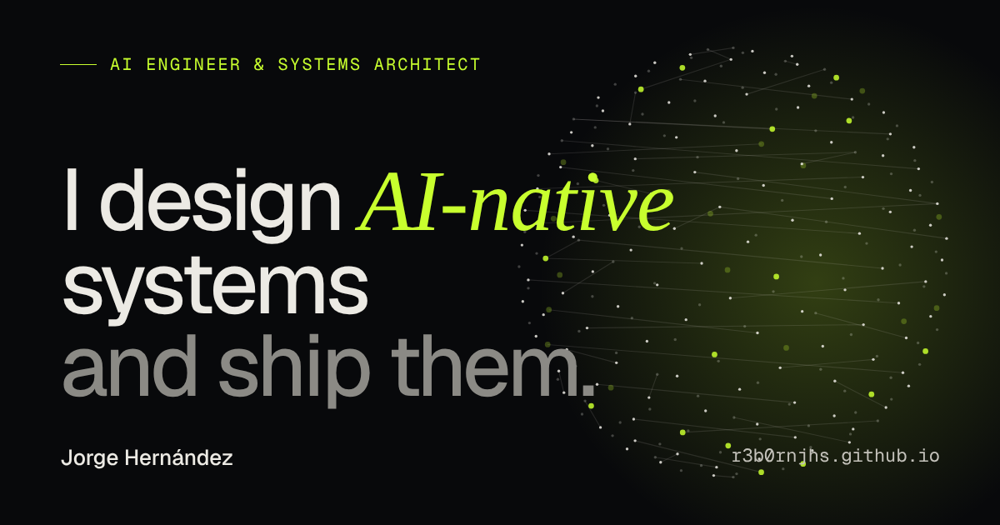

# r3b0rnjhs.github.io

[](https://github.com/r3b0rNjHs/r3b0rNjHs.github.io/actions/workflows/ci.yml)

Personal site of **Jorge Hernández Suárez**, AI Engineer & Systems Architect.
Live at **[r3b0rnjhs.github.io](https://r3b0rnjhs.github.io)** · English by default, Spanish at [`/es/`](https://r3b0rnjhs.github.io/es/).



## Highlights

- **Interactive WebGL hero**: A "neural field" of ~7k nodes rendered with custom GLSL shaders. It bends towards the pointer, ripples on click and disperses on scroll. It loads after first paint, pauses off-screen and frees all GPU resources on navigation.
- **Bilingual by design**: Typed EN/ES dictionaries with compile-time key parity, `hreflang` alternates, a language switch that keeps the current page, and a localised sitemap.
- **Case studies, not thumbnails**: Each project has its own page covering the challenge, the approach, the outcome and an _AI in the loop_ section.
- **Writing**: Bilingual articles as a Markdown content collection, with reading time, Shiki code highlighting in both themes and an RSS feed per language.
- **CV from the same data**: `/cv/` renders the CV from the site's typed content, and CI prints it to A4 PDFs in English and Spanish on every deploy.
- **Keyboard-first**: A `⌘K` command palette with fuzzy search, plus a skip link and visible focus states.
- **Accessible and respectful**: WCAG 2.1 AA checked with axe in CI, `prefers-reduced-motion` and `prefers-color-scheme` honoured, and light/dark themes with no flash.
- **Fast**: Static HTML, responsive WebP images, self-hosted variable fonts and zero runtime framework. The only heavy dependency (three.js) is loaded lazily.

## Stack

| Concern   | Choice                                                               |
| --------- | -------------------------------------------------------------------- |
| Framework | [Astro 7](https://astro.build) (static output, view transitions)     |
| Language  | TypeScript (strict)                                                  |
| Graphics  | three.js + hand-written GLSL                                         |
| Styling   | Plain CSS with design tokens and scoped component styles             |
| Testing   | Vitest (unit) · Playwright (e2e, desktop + mobile) · axe-core (a11y) |
| Quality   | `astro check` · Prettier · Dependabot                                |
| Delivery  | GitHub Actions → GitHub Pages                                        |

## Architecture

```
src/
├─ lib/          Pure, framework-free logic (math, geometry, fuzzy search, time, portrait field), fully unit-tested
├─ i18n/         Dictionaries + locale routing helpers
├─ data/         Typed content: profile, experience, projects (single source of truth for both languages)
├─ scripts/      Progressive-enhancement behaviour (hero scene, interactions, command palette)
├─ components/   Presentational Astro components (one section each)
├─ views/        Page compositions shared by both locales
├─ layouts/      Document shell: SEO, theming, navigation
└─ pages/        Thin route files: `/` and `/es/` render the same views with a different `lang`
```

The rules that keep it maintainable:

- **Content is data.** Every string a visitor reads lives in `src/data` or `src/i18n`, typed as `{ en, es }`. A unit test fails the build if any translation is missing.
- **Logic is pure.** Anything with branching lives in `src/lib` with no DOM access, so it can be tested in milliseconds.
- **Enhancement is optional.** Every page is complete HTML without JavaScript. Scripts clean up after themselves on every client-side navigation.

Design decisions are recorded as ADRs in [`docs/adr`](docs/adr).

## Development

Requires Node 22.12+.

```bash
npm install
npm run dev          # http://localhost:4321
```

| Script             | What it does                                                                          |
| ------------------ | ------------------------------------------------------------------------------------- |
| `npm run verify`   | Formatting, type-check, unit tests and build (same gate as CI)                        |
| `npm test`         | Unit tests (Vitest)                                                                   |
| `npm run test:e2e` | Playwright e2e + accessibility tests against `dist/` (run `npm run build` first)      |
| `npm run cv`       | Prints `/cv/` and `/es/cv/` to A4 PDFs in `dist/cv/` (run after `npm run build`)      |
| `npm run links`    | Checks every internal link, image and `#fragment` in `dist/` (after `build` and `cv`) |
| `npm run og`       | Regenerates `public/og.png` from code                                                 |
| `npm run format`   | Formats the codebase with Prettier                                                    |

## CI/CD

Every push and pull request runs [`ci.yml`](.github/workflows/ci.yml):

1. **Verify**: formatting, `astro check`, unit tests, production build, CV PDFs and an internal link check.
2. **End-to-end & accessibility**: Playwright on desktop and mobile viewports against the built site, including axe WCAG 2.1 AA scans.
3. **Deploy**: only from `main`, and only when both previous jobs are green.

A separate weekly workflow ([`links.yml`](.github/workflows/links.yml)) checks every external link with lychee and opens an issue if one breaks, so a slow third-party site never blocks a deploy.

## Working with AI

This project is built with an AI pair-programmer (Claude Code) inside a deliberate engineering process.
[`CLAUDE.md`](CLAUDE.md) is the project memory: architecture rules, conventions and the definition of done.
Every change still goes through the same gate: types, tests, accessibility checks and review.

## License

© Jorge Hernández Suárez. All rights reserved.
